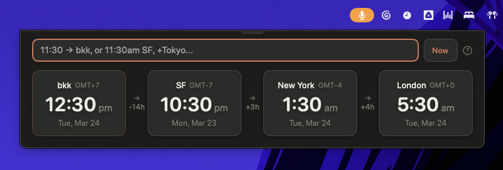
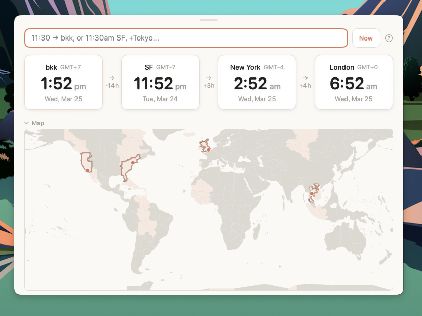

# TimeZoner

I work across Bangkok, San Francisco, New York, and London. Every day I need to coordinate meetings across these timezones. Going to Google and typing "what time is 3pm SF in Bangkok" is slow — the results page loads, I click through, sometimes the AI answer helps but it takes seconds to think. I just want to type and see the answer instantly.

TimeZoner is a tiny macOS app that floats over everything. Type a time, see it in all your zones. That's it.

The latest tagged release is **v0.3.0**. Calendar Companion described below is available only in the current source branch; it has not been released in the v0.3.0 DMG or stable Homebrew formula.


*Docked to the menu bar*


*Floating, with the timezone map open*

## Install

Requires macOS 14+ (Sonoma).

TimeZoner does not require a paid Apple Developer account to install locally. The clean install paths build the app from source on your Mac and ad-hoc sign it there.

### Cleanest local install

Use this if you want the app in `~/Applications` and do not care about Homebrew.

```bash
git clone https://github.com/nembal/Timezoner.git
cd Timezoner
./install.sh --open
```

This builds TimeZoner, signs it locally, and installs it to:

```bash
~/Applications/TimeZoner.app
```

Use `./install.sh --applications` for `/Applications`, or `./install.sh --destination /path/to/Applications` for another folder.

If your Mac does not have Apple's command line tools yet, install them first:

```bash
xcode-select --install
```

### Cleanest Homebrew install

Use this if you want Homebrew to manage the build and updates.

```bash
brew tap nembal/timezoner https://github.com/nembal/Timezoner
brew trust --formula nembal/timezoner/timezoner
brew install timezoner
timezoner-install-app
open ~/Applications/TimeZoner.app
```

`timezoner-install-app` copies the built app bundle to `~/Applications/TimeZoner.app`, so it is available from Finder, Spotlight, and Launchpad. The `timezoner` command also opens the Homebrew Cellar app bundle directly.

After `brew upgrade timezoner`, run `timezoner-install-app` again to update the separate copy in `~/Applications`. The helper stops an exact running destination bundle before replacing it; add `--open` if you want it relaunched. It refuses an update when another TimeZoner copy is running, so quit that copy first. Upgrading Homebrew alone updates only its Cellar bundle.

Homebrew may require the `brew trust` step for third-party taps before it loads the formula. To build the latest `main` instead of the tagged release:

```bash
brew install --HEAD nembal/timezoner/timezoner
timezoner-install-app
```

### Manual DMG install

The DMG is a fallback for people who prefer dragging the app into Applications:

**[Download the latest release DMG](https://github.com/nembal/Timezoner/releases/latest)**

Open the DMG, drag TimeZoner to Applications, then right-click and choose Open on first launch if macOS asks you to confirm trust. The app is ad-hoc signed but not Apple-notarized.

### Raycast local install

Until the Raycast Store PR is merged, run the extension locally:

```bash
git clone https://github.com/nembal/Timezoner.git
cd Timezoner/raycast
npm install
npm run dev
```

Open Raycast and type `tz` to launch **TimeZoner**. The Raycast extension works on its own; installing the native app is only needed for the **Open in TimeZoner** deep link.

## How it works

**Just start typing.** The chat field is focused when the app opens. Type a time and a city, hit Enter.

### Set a time in any zone
```
3pm SF              → all cards update
11:30am bangkok     → all cards update
15:00 BKK           → 24-hour format works too
noon NYC            → special words work
```

### Compare across zones
```
1130am BKK in SF    → sets Bangkok time, highlights both cards
3pm london in tokyo → see what London afternoon is in Tokyo
```

### Quick bare time (applies to your active zone)
```
11:30               → updates whichever card was last edited
3pm                 → first card is your "home" zone by default
```

### Add and remove zones
```
+Tokyo              → adds a Tokyo card
add Hong Kong       → adds Hong Kong
-SF                 → removes SF
remove Europe       → removes Europe
```

### Timezone map

There's a world map below the cards. Your zones show up as highlighted bands with city dots. Hover any region to see the GMT offset, click to add it as a new card. The boundaries follow real timezone lines (not straight vertical stripes), so half-hour zones like India and Nepal show up correctly. Collapse it if you don't need it.

### Edit cards directly

Click any time on a card and start typing. All other cards update live as you type. Type `12` and it becomes 12:00. Type `3pm` and it becomes 15:00. Hit Enter or click away to finish.

In the current source branch, cards have equal 200-point widths so city names such as New York and Budapest have room beside their GMT offsets. Adding a city widens the panel while space permits. When the panel reaches the display width, scroll the card row horizontally to reach the remaining cities. Conversions automatically bring highlighted city results into view. Cards have no ellipsis menu: click the time to edit, drag the top pill to reorder, and use the top-right remove button that appears on hover. Calendar mode keeps its flexible vertical city rail.

### Drag to reorder

Hover a card and a small pill appears at the top. Grab it and drag left or right to rearrange your zones.

### Docks to the menu bar

The app starts right below your menu bar with a clean flat top. Drag it down to use it as a floating widget anywhere on screen. It remembers where you put it between launches.

### Stays on top

TimeZoner floats over all windows. Click the clock icon in your menu bar to show/hide it. Escape to dismiss. Global hotkey **⌘⌥T** toggles the panel from any app (rebindable in Settings).

### Settings

Click the ⚙ in the panel (or press **⌘,**) to open Settings:

- **Appearance** — System / Light / Dark override
- **Global hotkey** — click the recorder and press a new combo; Esc cancels, Clear unbinds
- **Launch at login** — opens automatically when you sign in
- **Input formats** — quick reference for the chat parser

### Calendar companion (current source branch, unreleased)

TimeZoner can show a read-only agenda from the event calendars macOS Calendar already makes available. There is no Google sign-in, Google Calendar API, TimeZoner account, or direct network calendar client: macOS Calendar remains the account and sync source. The compact calendar is visible by default when the preference is unset; the calendar button hides or shows it. Opening it without access presents an in-app explanation, and only choosing **Enable Calendar Access** asks macOS for **Full Access**. TimeZoner never creates, edits, deletes, accepts, or declines calendar events.

The compact calendar's date-only header expands into the week/range workspace with stacked city times in the adjacent rail. **Expand TimeZoner** returns to the normal panel; selecting a timed event stays in the calendar workspace while showing that instant across every saved city. Settings belongs to the large calendar panel while the workspace is open. The normal map's neutral day/night overlay and hour scale follow that same shared reference moment. The calendar supports Today, 3 Days, and Week read-only views plus per-calendar **Show** controls. It can show local attendee labels; if macOS Calendar has no display name for an attendee, TimeZoner may use that attendee's address-derived label locally.

TimeZoner does not keep an app-owned event or attendee database. It keeps ordinary settings and per-calendar preference flags. Optional Calendar alerts are off by default and use configurable 30- and 10-minute lead times; clearing either completed lead field disables only that reminder. When alerts are enabled, macOS retains the event title, occurrence identifier, and start time in its local notification queue for the next seven-day scheduling horizon so a notification can be delivered and opened. The alert lifecycle serializes scheduling and cleanup so a later disable or loss of Calendar access supersedes in-flight TimeZoner-owned requests. There is no background agent: changes made after TimeZoner quits are not reconciled until it runs again, and it cannot extend the horizon while it remains quit. The native notification authorization, delivery, click-routing, and changed-rebuild checks are still recorded as pending manual verification in [the Calendar verification record](docs/verification/calendar-permission-spike-2026-09-24.md).

### Works offline

376 built-in timezone aliases — cities, abbreviations (SF, NYC, HK, BKK), airport codes (SFO, JFK, LHR), country names. Timezone conversion needs no network, API key, or account. Calendar Companion reads the locally available macOS Calendar database; macOS manages syncing for any accounts configured there. TimeZoner itself has no account, API key, Google OAuth flow, or network calendar client.

## Forgiving input

The parser handles messy typing. All of these work:

| Input | What it does |
|-------|-------------|
| `11:30am SF` | Standard format |
| `1130 am sf` | No colon, lowercase |
| `1130 a BKK` | Just "a" for AM |
| `3 p sf` | Just "p" for PM |
| `11:30 a.m. NYC` | Dotted AM/PM |
| `15:00 BKK` | 24-hour |
| `noon NYC` | Special words |
| `midnight CET` | Midnight |
| `1130am BKK in SF` | Cross-zone query |
| `+Tokyo` | Add zone |
| `-SF` | Remove zone |
| `12` | Bare time → active zone |

##  Raycast Extension

If you use [Raycast](https://www.raycast.com/), TimeZoner works there too. The extension is implemented in this repo and installs from source while the public Store submission is in review. Open **TimeZoner** with `tz`, then type `3pm in SF` to see that time across every saved zone.

| Command | Keyword | What it does |
|---------|---------|-------------|
| TimeZoner | `tz` | Shows current time across saved zones, converts typed times, and manages zones |

Uses the same 376 timezone aliases as the macOS app.

The Raycast command supports `3pm in SF`, `3pm SF`, `Tokyo`, `+Tokyo`, `add Hong Kong`, `-SF`, and `remove NYC`. Saved zones appear as timezone cards in a row, with the static boundary map underneath. Select any zone card and press **Enter** to switch the search bar into edit mode for that card; type `4:30 PM`, `16:30`, `15`, `430pm`, `noon`, or `midnight`, and every other zone recalculates live from that selected timezone. While editing, selecting another card retargets the search bar to that card in one click. The map is rendered from bundled timezone boundary data, with visible zones, matching UTC-offset regions, exact dots for common city zones, and deterministic offset markers for less common zones. You can also manage zones from the action panel: **⌘N** opens Add Zone, and **⌘E** edits the selected saved zone. Raycast stores its zone list in Raycast LocalStorage. It does not sync that list with the macOS app. Press **⌘O** from Raycast to open TimeZoner.app through the `timezoner://` URL scheme when the app is installed.

### Local Raycast install

```bash
git clone https://github.com/nembal/Timezoner.git
cd Timezoner/raycast
npm install
npm run dev
```

Open Raycast, type `tz` to open **TimeZoner**, then enter `3pm in SF`.

> You can also import it manually: Raycast → Settings → Extensions → `+` → Import Extension → select the [`raycast/`](https://github.com/nembal/Timezoner/tree/main/raycast) directory.

Raycast Store submission is tracked at [raycast/extensions#29168](https://github.com/raycast/extensions/pull/29168). The extension code, metadata screenshots, and current CI fixes are in the PR branch; public Store install depends on Raycast review and merge.

## Build from source

```bash
git clone https://github.com/nembal/Timezoner.git
cd Timezoner
./build.sh
open app/TimeZoner.app
```

Create a Manual DMG for this checkout's version: `./scripts/create-dmg.sh`. The version comes from `app/Info.plist`; an optional version argument must match it. Current source uses `0.4.0` as build metadata for unreleased Calendar work, not as a release announcement.

Run checks:

```bash
scripts/test-install.sh
cd app && swift run TimeZonerTests
cd ../raycast && npm test && npm run lint && npm run build
```

Deep-link smoke test:

```bash
open "timezoner://open"
open "timezoner://set?hour=15&minute=30&zone=America%2FLos_Angeles&label=SF"
```

Release readiness is tracked in [docs/RELEASE_READINESS.md](docs/RELEASE_READINESS.md).

## Tech stack

- **SwiftUI + AppKit** — borderless floating NSPanel
- **Swift Package Manager** — no Xcode project needed
- **macOS 14+** — Observation framework (`@Observable`)
- **Zero dependencies** — no network, no external packages

## License

MIT — see [LICENSE](LICENSE).
